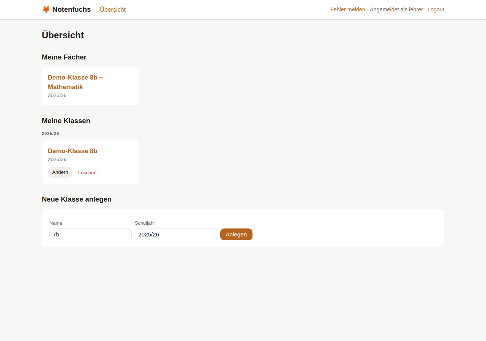
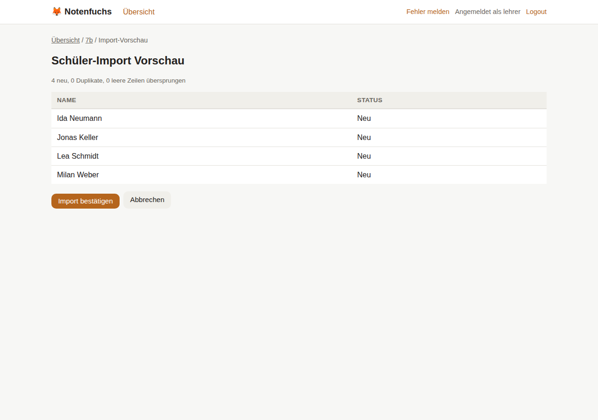
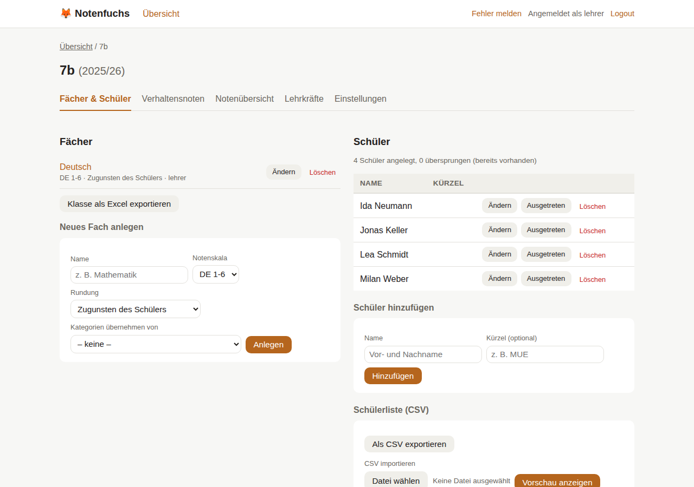

# Schuljahresbeginn: Klasse, Schüler und Fächer anlegen

## Klasse anlegen

Auf der **„Übersicht“** tragen Sie unter „Neue Klasse anlegen“ den Namen und das Schuljahr
ein und klicken auf **„Anlegen“**.

## Schüler importieren

Öffnen Sie die Klasse. Unter **„Schülerliste (CSV)“** wählen Sie eine CSV-Datei aus, zum
Beispiel den Export aus der Schulverwaltung, und klicken auf **„Vorschau anzeigen“**.
Notenfuchs versteht eine Spalte „Name“ oder getrennte Spalten „Vorname“ und „Nachname“,
mit Semikolon oder Komma getrennt.

Die Vorschau zeigt, welche Schüler neu sind und welche es schon gibt. Erst mit
**„Import bestätigen“** werden die neuen Schüler angelegt.

Einzelne Schüler tragen Sie unter **„Schüler hinzufügen“** ein. Statt des echten Namens
können Sie auch nur ein Kürzel verwenden.

## Fach anlegen

Unter **„Neues Fach anlegen“** geben Sie den Namen des Fachs, die Notenskala und die
Rundung ein und klicken auf **„Anlegen“**.

## Kategorien festlegen

Ein Klick auf das Fach öffnet die **„Notenerfassung“**. Ein neues Fach hat noch keine
Kategorien. Mit **„Mit Schriftlich 50 % / Mündlich 50 % starten“** legen Sie die häufigste
Aufteilung mit einem Klick an. Eigene Kategorien und Gewichtungen legen Sie im Reiter
**„Leistungen & Gewichtung“** fest; ändern lässt sich beides jederzeit.

## Weitere Fächer

Unterrichten Sie mehrere Fächer mit derselben Aufteilung, wählen Sie beim Anlegen unter
**„Kategorien übernehmen von“** ein Fach aus, das Sie schon eingerichtet haben. Übernommen
werden die Kategorien und ihre Gewichtung, keine Leistungen und keine Noten.
