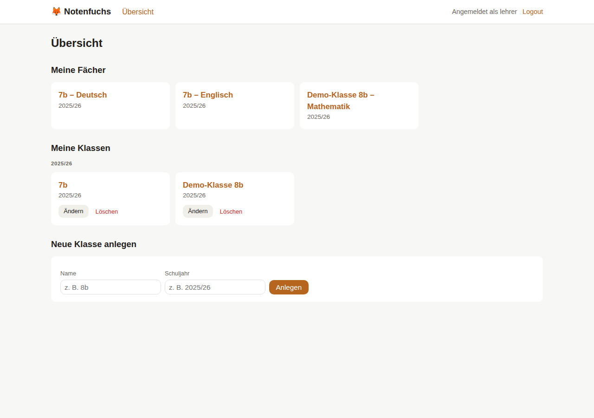
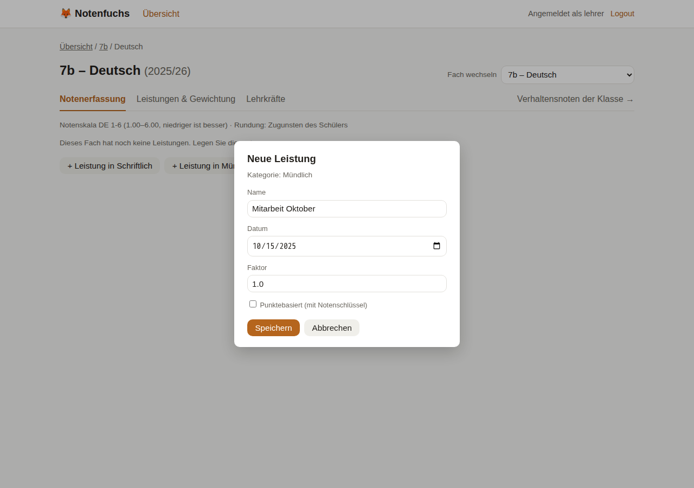
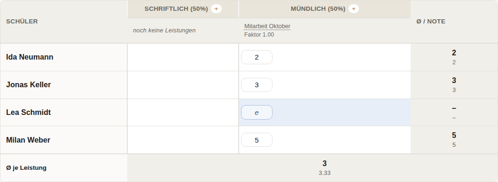
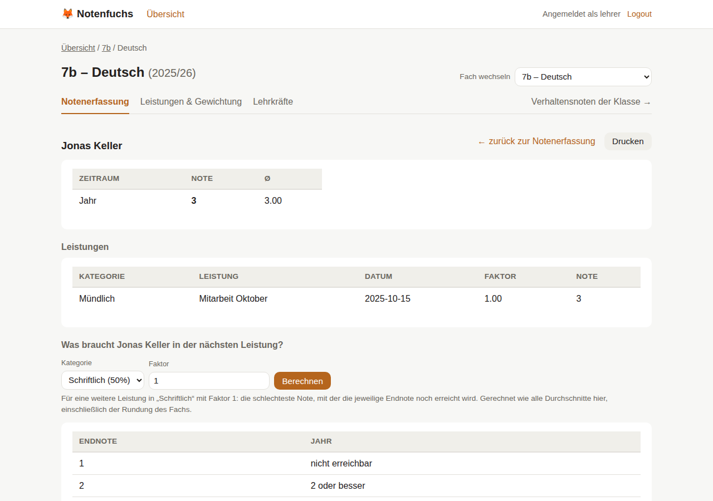

# Alltag: Leistungen anlegen und Noten eintragen

## Zum Fach

Die **„Übersicht“** zeigt unter **„Meine Fächer“** alle Fächer, die Sie im aktuellen
Schuljahr unterrichten. Ein Klick auf eine Karte öffnet direkt die Notentabelle. Fehlen
Noten, steht auf der Karte, wie viele.

## Neue Leistung

Neben jeder Kategorie in der Notentabelle steht ein „+“. Solange ein Fach noch keine
Leistung hat, gibt es stattdessen Knöpfe wie **„+ Leistung in Mündlich“**. Im Fenster
tragen Sie den Namen, das Datum (heute ist vorbelegt) und den Faktor ein und klicken auf
**„Speichern“**. Faktor 2 bedeutet: Die Leistung zählt doppelt.

## Noten eintragen

Nach dem Speichern steht der Cursor schon in der neuen Spalte. Tippen Sie die Note ein;
Enter springt zum nächsten Schüler, Tab zur nächsten Spalte. Jede Zelle speichert sich
beim Verlassen von selbst. Komma und Punkt gehen beide (2,3). Eine geleerte Zelle löscht
die Note.

War ein Schüler nicht da, tragen Sie **e** (entschuldigt) oder **u** (unentschuldigt) ein,
allein oder neben der Note, zum Beispiel „6 u“. Der Vermerk ändert die Note nie; eine
Zelle nur mit Vermerk zählt nicht als fehlende Note. Wer es vergisst: Fährt man mit der Maus
über eine Zelle, steht es dort auch.

Blau sind Zellen mit Abwesenheitsvermerk. Gelb sind leere Zellen einer Leistung, deren
Datum schon erreicht ist: Hier fehlt noch eine Note.

## Leistung ändern oder löschen

Ein Klick auf den Namen einer Leistung im Tabellenkopf öffnet dasselbe Fenster. Dort
ändern Sie Name, Datum und Faktor oder entfernen die Leistung mit **„Leistung löschen“**.

## Ein Schüler im Fach

Ein Klick auf einen Schülernamen öffnet seine Seite: alle Leistungen mit Datum und Note,
die Durchschnitte und darunter, welche Note er in der nächsten Leistung braucht, um eine
bestimmte Endnote zu erreichen. Kategorie und Faktor der nächsten Leistung wählen Sie
selbst und klicken auf **„Berechnen“**. Mit **„Drucken“** nehmen Sie die Seite zum
Elterngespräch mit.

