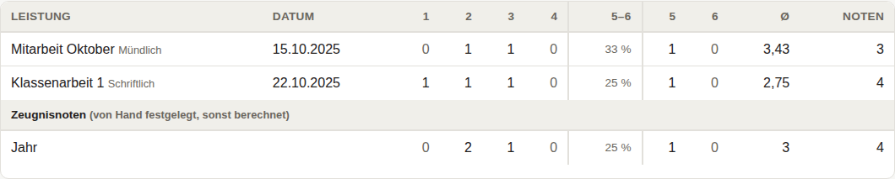

# Klassenarbeit mit Punkten und Notenschlüssel

## Leistung mit Punkten anlegen

Klicken Sie auf das „+“ neben der Kategorie, zum Beispiel „Schriftlich“, und setzen Sie im
Fenster den Haken bei **„Punktebasiert (mit Notenschlüssel)“**. Für eine Klassenarbeit, die
doppelt zählt, tragen Sie Faktor 2 ein.

Tragen Sie die **„Höchstpunktzahl“** der Arbeit ein. Darunter füllt sich sofort der
**„Notenschlüssel“** aus den Prozentwerten des Fachs. Jede Zeile nennt eine Note und ihre
Punkte. Die Punkte gehen in halben Schritten und sind abgerundet, damit das Runden keine Note
schwerer macht.

Der Schlüssel lässt sich auf zwei Arten lesen:

- **Stufen** (ohne Haken bei „Gleitend“): Die Note gilt ab ihren Punkten. Mit „2 ab 30“ und
  „1 ab 35“ bekommt man für 30 bis 34,5 Punkte eine 2. Unter der letzten Zeile gibt es die
  schlechteste Note.
- **„Gleitend“**: Die Note steigt zwischen zwei Zeilen gleichmäßig. Mit „1 bei 40“ und
  „3,5 bei 20“ gibt es für 30 Punkte eine 2,2. Gerundet wird auf eine Stelle nach dem Komma,
  immer zugunsten des Schülers. Über die erste und unter der letzten Zeile hinaus läuft die
  Note weiter, bis zur besten und zur schlechtesten Note.

## Punkte eintragen

In die Spalte tragen Sie die erreichten Punkte ein. Daneben erscheint sofort die Note, die
sich aus dem Notenschlüssel ergibt. Gespeichert werden nur die Punkte; ändern Sie später
den Notenschlüssel, passen sich alle Noten an. Zusatzpunkte über der Höchstpunktzahl geben
die beste Note.

## Notenschlüssel anpassen

Ein Klick auf den Namen der Klassenarbeit öffnet das Fenster wieder. Sie können jede Zeile
für diese Arbeit ändern, zum Beispiel die 4 nach einer schweren Arbeit einen Punkt
niedriger ansetzen. Mit **„+ Zeile“** fügen Sie eine Zeile hinzu, etwa eine 2+ ab 32 Punkten.
**„Schlüssel des Fachs anwenden“** setzt alle Zeilen wieder auf die Prozentwerte des Fachs,
zum Beispiel nachdem Sie die Höchstpunktzahl geändert haben.

Während Sie ändern, zeigt der **„Notenspiegel“** darunter, wie viele Schüler mit diesem
Schlüssel welche Note bekämen, und den Durchschnitt. Erst **„Speichern“** übernimmt den
Schlüssel.

## Notenschlüssel des Fachs

Die Prozentwerte, aus denen eine neue Arbeit ihren Schlüssel berechnet, stehen im Reiter
**„Leistungen & Gewichtung“** unter „Notenschlüssel“. Am Anfang sind es Stufen: die 4 ab
50 %, die besseren Noten gleichmäßig darüber und die 5 ab 25 %. Tragen Sie dort ein, was Ihre
Fachkonferenz festgelegt hat. Zeilen lassen sich hinzufügen und entfernen, zum Beispiel für
einen gleitenden Schlüssel mit nur drei Zeilen: 1 ab 100 %, 3,5 ab 50 %, 6 ab 20 %. Schon
angelegte Arbeiten behalten ihren Schlüssel; ein Klick auf „Schlüssel des Fachs anwenden“
übernimmt die neuen Werte auch dort.

## 2- oder 2,3?

Ob Noten mit Tendenz als „2-“ oder als „2,3“ erscheinen, stellen Sie pro Fach ein: auf der
Seite der Klasse bei „Ändern“ neben dem Fach. Eintippen können Sie beides.

## Notenspiegel für alle Leistungen

Der Reiter **„Notenspiegel“** zeigt für jede Leistung des Fachs, wie oft jede Note vergeben
wurde, dazu den Durchschnitt und die Zahl der Noten. Eine 2- zählt dabei als 2. Die
schmale Spalte zwischen 4 und 5 zeigt den Anteil der Noten 5 und 6, den viele Schulen für
die Genehmigung einer Klassenarbeit brauchen. Ganz unten stehen die Zeugnisnoten: die von
Hand festgelegte, sonst die berechnete. Die Seite lässt sich drucken.

