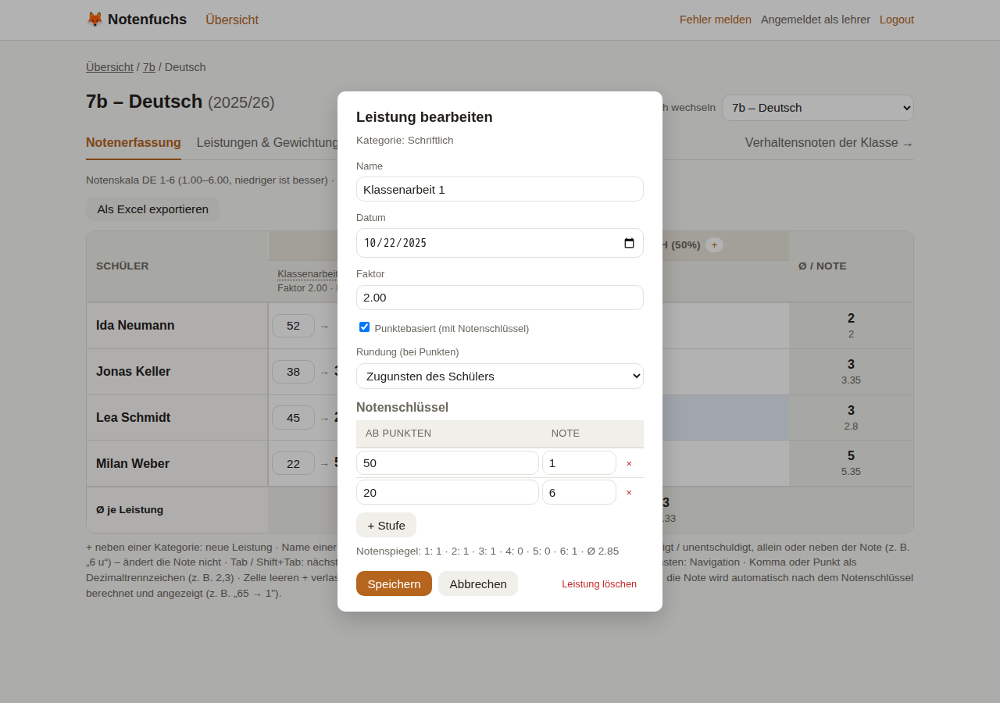
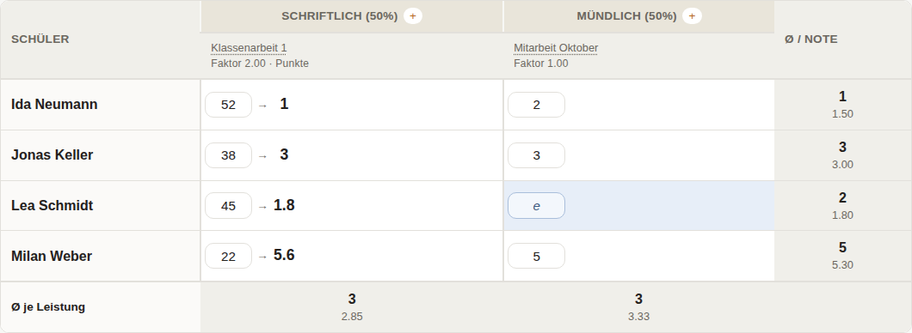

# Klassenarbeit mit Punkten und Notenschlüssel

## Leistung mit Punkten anlegen

Klicken Sie auf das „+“ neben der Kategorie, zum Beispiel „Schriftlich“, und setzen Sie im
Fenster den Haken bei **„Punktebasiert (mit Notenschlüssel)“**. Für eine Klassenarbeit, die
doppelt zählt, tragen Sie Faktor 2 ein.

## Punkte eintragen

In die Spalte tragen Sie die erreichten Punkte ein. Daneben erscheint sofort die Note, die
sich aus dem Notenschlüssel ergibt. Gespeichert werden nur die Punkte; ändern Sie später
den Notenschlüssel, passen sich alle Noten an.

## Notenschlüssel anpassen

Ein Klick auf den Namen der Klassenarbeit öffnet das Fenster mit dem **„Notenschlüssel“**.
Jede Zeile sagt: **„ab Punkten“** so viel gibt es diese **„Note“**. Zwischen zwei Zeilen
steigt die Note gleichmäßig an. Am Anfang stehen zwei Zeilen (60 Punkte → 1, 20 Punkte → 6);
mit **„+ Stufe“** fügen Sie weitere hinzu.

Während Sie ändern, zeigt der **„Notenspiegel“** darunter, wie viele Schüler mit diesem
Schlüssel welche Note bekämen, und den Durchschnitt. Erst **„Speichern“** übernimmt den
Schlüssel.

Unter **„Rundung (bei Punkten)“** wählen Sie, ob die Note immer zugunsten des Schülers
oder kaufmännisch gerundet wird.

