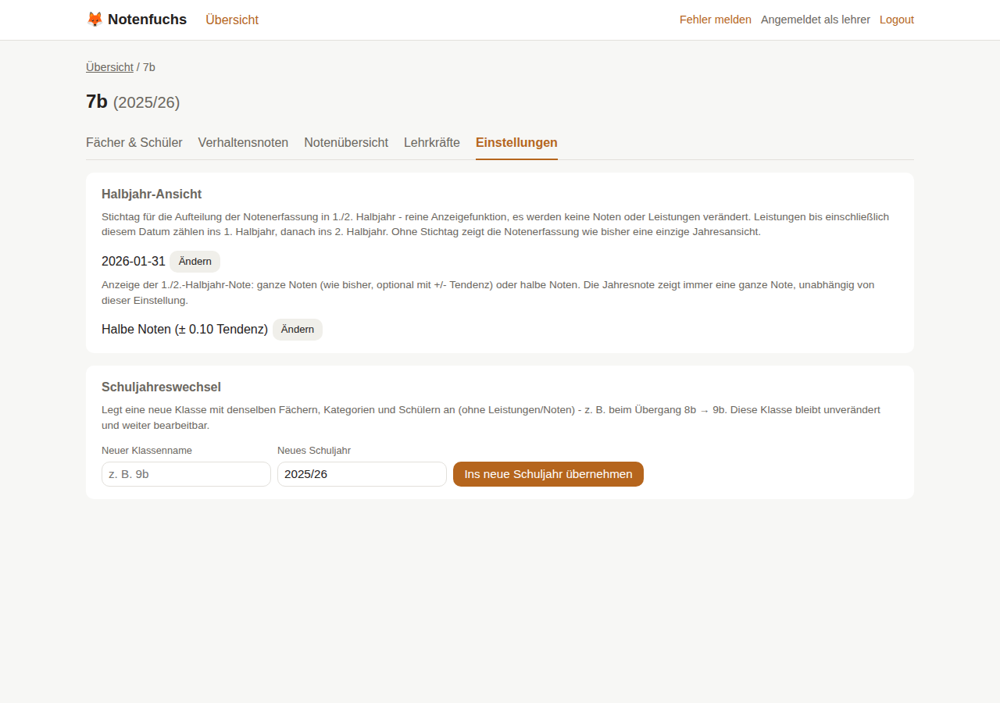
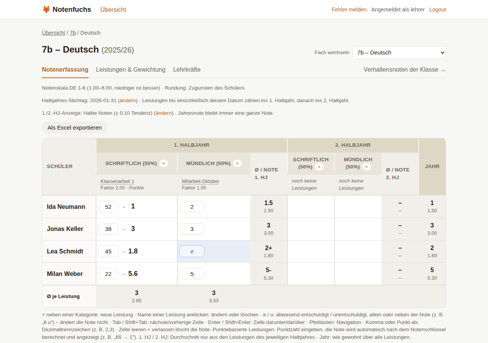
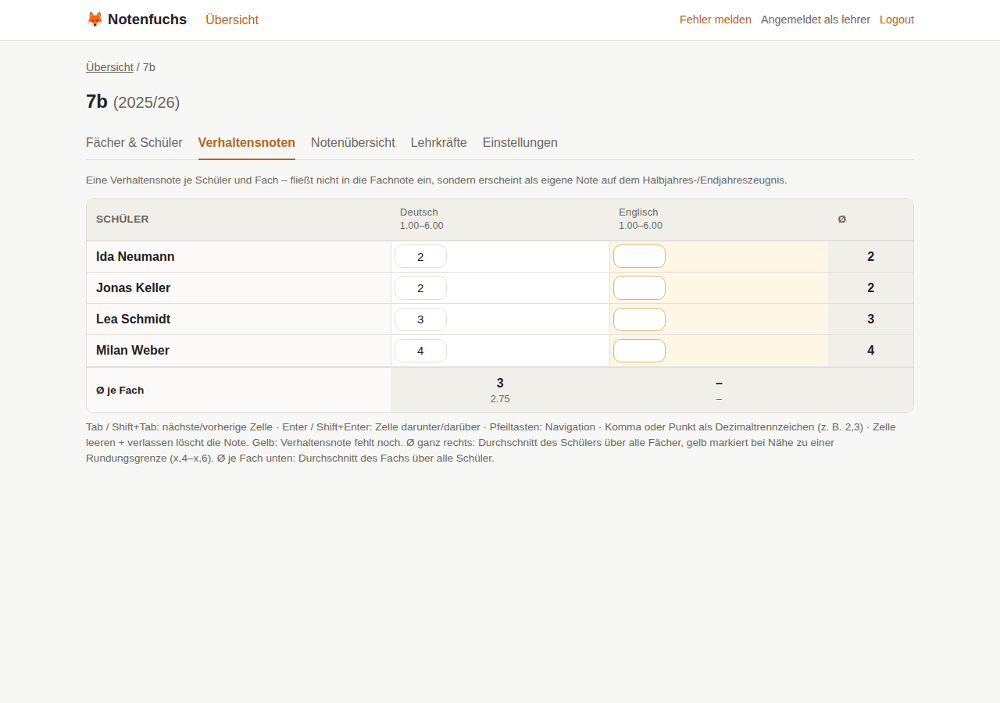
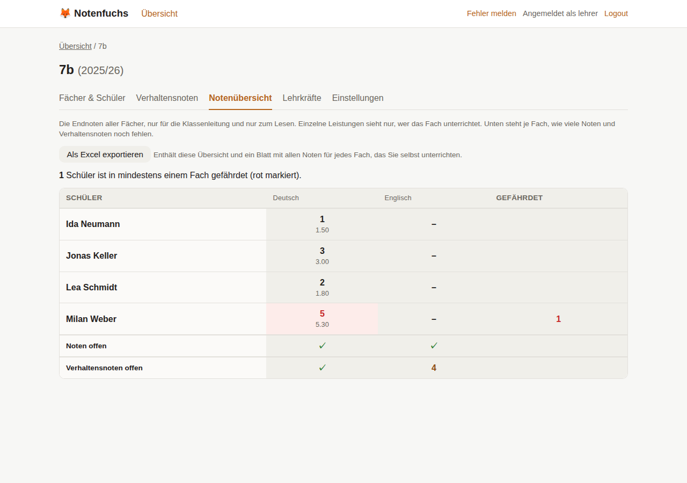

# Vor dem Zeugnis

## Halbjahre einstellen

Die Klassenleitung legt im Reiter **„Einstellungen“** der Klasse unter
**„Halbjahr-Ansicht“** den Stichtag fest. Leistungen bis zu diesem Tag zählen ins erste
Halbjahr, spätere ins zweite. Dort lässt sich auch einstellen, ob die Halbjahresnoten als
ganze Noten mit Tendenz oder als halbe Noten erscheinen.

Die Notentabelle teilt sich dann in **„1. Halbjahr“**, **„2. Halbjahr“** und die
Jahresnote, jeweils mit eigenem Durchschnitt. Die Noten selbst ändern sich dadurch nicht.
Welchem Halbjahr eine Leistung angehört, bestimmt ihr Datum. Das „+“ in einem Halbjahr
schlägt deshalb ein Datum in diesem Halbjahr vor.

## Verhaltensnoten

Über **„Verhaltensnoten der Klasse“** im Fach (oder den Reiter **„Verhaltensnoten“** der
Klasse) tragen Sie für jeden Schüler eine Verhaltensnote je Fach ein. Bearbeiten können Sie
nur die Spalten Ihrer eigenen Fächer. Gelb markierte Zellen fehlen noch.

## Notenübersicht für die Klassenleitung

Der Reiter **„Notenübersicht“** zeigt die Endnoten aller Fächer für jeden Schüler. Rot
markiert sind Noten, bei denen ein Schüler gefährdet ist (5 oder schlechter). Unten steht je
Fach, wie viele Noten (**„Noten offen“**) und Verhaltensnoten (**„Verhaltensnoten offen“**)
noch fehlen.

## Export

**„Als Excel exportieren“** in der Notenübersicht oder **„Klasse als Excel exportieren“** auf
der Klassenseite lädt eine Excel-Datei herunter: die Notenübersicht (nur für die
Klassenleitung) und für jedes Fach, das Sie unterrichten, ein Blatt mit allen Noten.
