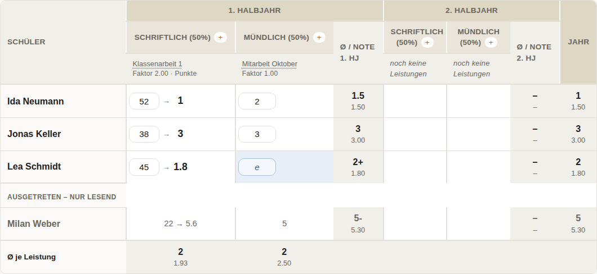

# Im Laufe des Jahres

## Ein Schüler verlässt die Klasse

Klicken Sie auf der Klassenseite neben dem Schüler auf **„Ausgetreten“**. Seine Noten
bleiben erhalten und erscheinen nur noch lesend unter den Notentabellen, damit Sie sie zum
Beispiel für ein Abgangszeugnis noch haben. In Durchschnitte und fehlende Noten zählt er
nicht mehr. Mit **„Wieder aufnehmen“** machen Sie das rückgängig.

**„Löschen“** dagegen entfernt den Schüler mit allen Noten. Das ist nur für Tippfehler
gedacht.

## Eine Kollegin unterrichtet mit

Im Reiter **„Lehrkräfte“** des Fachs wählen Sie die Kollegin aus und klicken auf
**„Zugriff gewähren“**. Sie sieht und bearbeitet dann alle Leistungen und Noten dieses
Fachs. In der Liste erscheint jede Lehrkraft, die sich einmal bei Notenfuchs angemeldet
hat.

