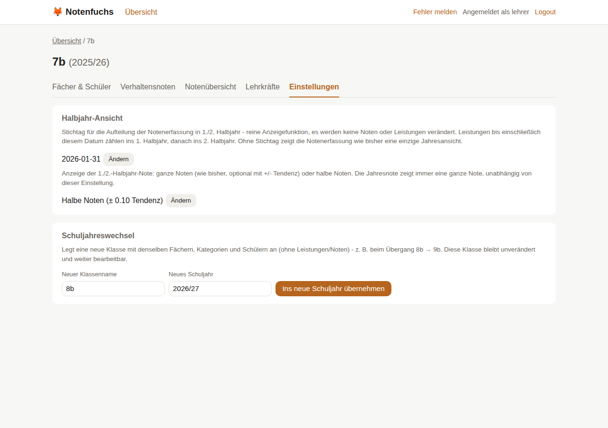

# Neues Schuljahr

Im Reiter **„Einstellungen“** der Klasse tragen Sie unter **„Schuljahreswechsel“** den neuen
Klassennamen und das neue Schuljahr ein und klicken auf **„Ins neue Schuljahr übernehmen“**.

Notenfuchs legt eine neue Klasse an, mit denselben Fächern, Kategorien und Schülern.
Ausgetretene Schüler kommen nicht mit, Leistungen und Noten auch nicht: Das neue Jahr
beginnt leer. Die alte Klasse bleibt unverändert erhalten.

Unter **„Meine Fächer“** auf der Übersicht stehen danach die Fächer des neuen Schuljahres.
