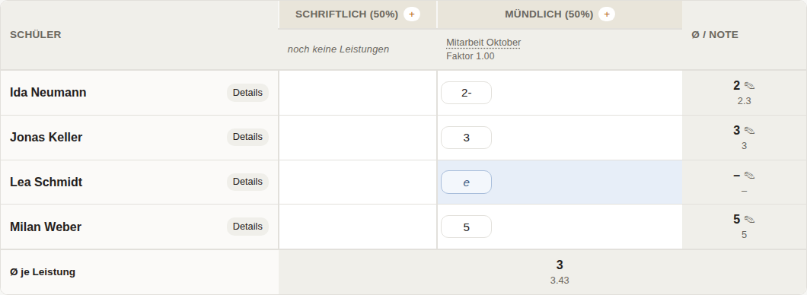
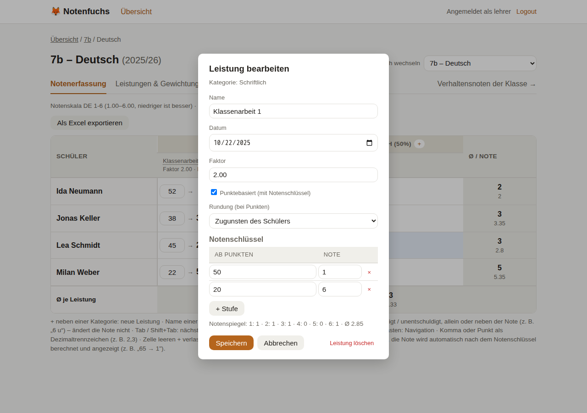

# Notenfuchs

Notenfuchs ist eine Notenverwaltung für Lehrkräfte. Sie tragen Noten in eine Tabelle ein,
Notenfuchs rechnet: gewichtete Durchschnitte pro Kategorie und Fach, gerundete Endnoten,
Halbjahre, Punkte mit Notenschlüssel. Notenfuchs ist quelloffen und läuft auf Ihrem eigenen
Server. Die Daten Ihrer Schüler verlassen ihn nicht.

## Was Notenfuchs kann

- **Noten eintragen wie in einer Tabelle.** Enter springt zum nächsten Schüler, jede Zelle
  speichert sich von selbst. Tendenzen tippen Sie als 2- oder 2+.
- **Gewichtung, wie Ihre Schule sie will.** Kategorien wie „Schriftlich“ und „Mündlich“ mit
  Prozenten, einzelne Leistungen mit Faktor.
- **Punkte und Notenschlüssel.** Punkte eintragen, die Note ergibt sich aus dem Schlüssel.
  Der Notenspiegel zeigt, wie oft jede Note vergeben wurde.
- **Halbjahre und Zeugnis.** Halbjahresnoten, Verhaltensnoten, eine Notenübersicht der
  ganzen Klasse und der Export nach Excel. Die Zeugnisnote legen Sie bei Bedarf von Hand fest.
- **Mehrere Lehrkräfte.** Jede Lehrkraft sieht nur ihre Fächer; die Klassenleitung sieht
  die Übersicht.

## Loslegen

- Die [Anleitung](anleitung/README.md) zeigt Notenfuchs Schritt für Schritt, vom
  Schuljahresbeginn bis zum Zeugnis.
- Wie Sie Notenfuchs auf einem Server betreiben, steht in der
  [README auf GitHub](https://github.com/Bytekeeper/Notenfuchs#notenfuchs-betreiben).
  Sie brauchen nur Docker.
